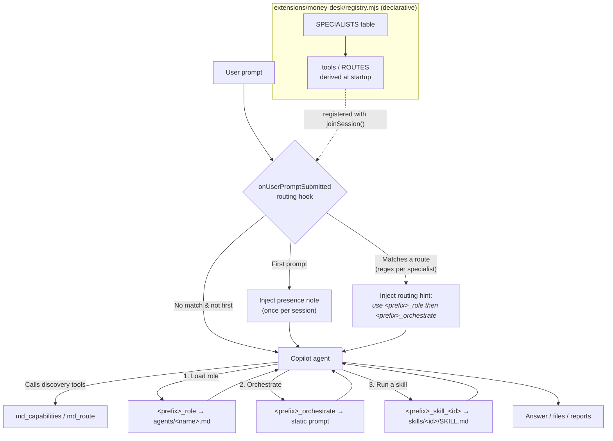

# Money Desk

[](LICENSE)
[](https://nodejs.org/)

**Your personal-finance AI team for GitHub Copilot CLI.** 20 specialist agents with 139 tools. **Every skill tool is intake-gated**: the first call returns the required-input checklist and forces Copilot to ask the user the listed questions in plain language (or render a structured `ask_user` form when a schema is shipped) before re-invoking the skill with the answers — so reports get built on `[USER-PROVIDED]` values, not invented `[ASSUMPTION:]` ones. A bundled 2026 facts table (IRS limits, brackets, IRMAA, FAFSA, conforming-loan, FEIE) means figures get cited from `md_facts` instead of marked `[UNSOURCED]`. Covers budgeting, taxes, investing, retirement, debt, credit, health & Medicare, property & casualty insurance, life & disability insurance, estate hygiene, major purchase decisions, education / 529 planning, net worth & goals tracking, self-employed / 1099 planning, cross-specialist life-event playbooks (annual review, new baby, job change, home purchase, inheritance, layoff), real-estate investing, behavioral coaching, international / expat planning, financial literacy (plain-language explanations + glossary + paycheck/statement walkthroughs + beginner roadmap + teach-a-kid), and FIRE planning (financial-independence strategy, safe-withdrawal stress testing, pre-59½ bridge / pre-65 healthcare, withdrawal-order, geographic arbitrage) — routed automatically. Zero runtime dependencies.

---

### 📌 Table of Contents

| | Section | Description |
|---|---------|-------------|
| 🚀 | [Quick Start](#quick-start) | One-command install |
| 💡 | [What is Money Desk?](#what-is-money-desk) | Overview and key concepts |
| 👥 | [The Team](#the-team) | All 20 specialists at a glance |
| 📦 | [Installation](#installation) | 5 ways to install |
| 🖥️ | [CLI Reference](#cli-reference) | `init`, `status`, `uninstall`, `--version` |
| ⚙️ | [How It Works](#how-it-works) | Architecture, routing, discoverability |
| 📝 | [Usage Examples](#usage-examples) | Example prompts for every specialist |
| 📂 | [Repository Structure](#repository-structure) | Folder tree and conventions |
| 🔒 | [Privacy & Guardrails](#privacy--guardrails) | What Money Desk will and won't do (full: [PRIVACY.md](./PRIVACY.md)) |
| 🔧 | [Troubleshooting](#troubleshooting) | Common issues and fixes |
| 🤝 | [Contributing](#contributing) | How to add a specialist or skill |
| 📄 | [License](#license) | MIT |

> 📋 **Full machine-readable capability map:** [docs/CAPABILITIES.md](./docs/CAPABILITIES.md) — auto-generated from the registry, lists every specialist, skill, and tool.

---

## Quick Start

```bash
npx github:dmauser/money-desk init
```

That's it. Launch Copilot CLI with experimental mode (`copilot --experimental`) in any repo and start asking personal-finance questions.

> _New to Copilot CLI?_ Install it from the [GitHub Copilot CLI docs](https://docs.github.com/copilot/concepts/agents/about-copilot-cli) first, then come back here.

## What is Money Desk?

Money Desk gives you a coordinated team of personal-finance specialist agents through [GitHub Copilot CLI](https://docs.github.com/copilot/concepts/agents/about-copilot-cli). Describe what you need — a budget review, a tax-loss harvest plan, a retirement projection, a buy-vs-lease analysis — and the coordinator routes your request to the right specialist automatically.

Each specialist runs with its own domain expertise, guardrails, and step-by-step playbooks. The coordinator handles routing and multi-domain orchestration so you don't have to remember which tool to call.

> **Analysis only** — Money Desk produces drafts and analysis for your review. It does **not** execute trades, move funds, file taxes, submit disputes, or sign legal documents. It is informational only — **not professional tax, legal, investment, or insurance advice**.

## The Team

| Specialist | Prefix | What They Do |
|------------|--------|--------------|
| **Budget Coach** | `md_bc` | Cashflow reviews, category audits, zero-based monthly plans, subscription cleanup |
| **Tax Planner** | `md_tx` | Return-prep checklists, withholding checks, deductions reviews, tax-loss harvesting |
| **Investing Advisor** | `md_iv` | Portfolio reviews, allocation checks, rebalance plans, fund-expense audits |
| **Retirement Planner** | `md_rp` | Retirement projections, contribution optimization, withdrawal sequencing, Social Security |
| **Debt Strategist** | `md_ds` | Payoff plans (avalanche/snowball), refinance analysis, credit-card strategy, student loans |
| **Credit & Identity** | `md_ci` | Credit-report reviews, score-improvement plans, dispute letters, ID-theft response |
| **Insurance — Health & Medicare** | `md_ih` | Health-plan selection (HDHP+HSA vs PPO), Medicare IRMAA, LTC planning |
| **Insurance — Property & Casualty** | `md_pc` | Auto / home / renters declarations-page audit, deductible optimizer, umbrella sizing |
| **Insurance — Life & Disability** | `md_lp` | Life-insurance needs (DIME/HLV), individual disability review, beneficiary audit |
| **Estate & Legacy** | `md_el` | Document inventories, beneficiary audits, basics checklist, digital-estate review |
| **Purchase Advisor** | `md_pa` | Buy-vs-lease, rent-vs-buy, big-purchase reviews, total cost of ownership |
| **Education Planner** | `md_ed` | 529 reviews, college-cost projections, FAFSA / financial-aid positioning, account-type selection |
| **Net Worth & Goals** | `md_nw` | Net-worth snapshots, emergency-fund sizing, goal-based savings plans, sinking funds |
| **Self-Employed Planner** | `md_se` | Solo 401k / SEP / SIMPLE selector, quarterly estimated taxes, S-corp election, Schedule C / QBI review |
| **Life Events** | `md_le` | Cross-specialist orchestrator — annual review, new baby, job change, home purchase, inheritance, layoff playbooks |
| **Real Estate Investor** | `md_re` | Rental-property underwriting (cap rate, cash-on-cash, DSCR), mortgage/refi strategy, house-hacking, real-estate tax strategy (depreciation, 1031, cost segregation), sell-vs-hold |
| **Behavioral Coach** | `md_bh` | Panic / FOMO circuit-breaker, money-script diagnostic, decision journal, couples money alignment, lifestyle-inflation audit |
| **International / Expat** | `md_in` | US-expat tax overview (FBAR, FATCA, FEIE vs FTC), cross-border investing (PFIC traps), currency/FX exposure, moving-country checklist |
| **Financial Literacy** | `md_fl` | Plain-language concept explainer (depth-calibrated), glossary lookups, paycheck walkthrough, account-type map, money-myths debunk, statement walkthrough (brokerage/401k/mortgage/EOB), 12-month beginner roadmap, teach-a-kid lessons + custodial Roth IRA pitch |
| **FIRE Planner** 🔥 | `md_fi` | Financial-Independence / Retire-Early strategy: FIRE number calculator, safe-withdrawal stress test (Bengen / Trinity / Kitces / VPW), lean / coast / barista / chubby / fat classifier, savings-rate optimizer, pre-59½ bridge strategy (SEPP/72(t), Roth ladder), pre-65 healthcare plan (ACA-MAGI / HSA), withdrawal-order optimizer, geographic arbitrage planner |

Each specialist exposes:

- `<prefix>_role` — the specialist's persona and workflow.
- `<prefix>_orchestrate` — step-by-step orchestration prompt.
- `<prefix>_skill_<id>` — one per skill (typically 3–5 per specialist).

Plus four top-level discovery / reference tools:

- `md_capabilities` — list the full team and their skills.
- `md_route` — given a query, return the most relevant specialist(s).
- `md_facts` — curated 2026 reference data (IRS contribution limits, tax brackets, IRMAA brackets, FAFSA / Pell, Social Security wage base, Medicare premiums, estate exemptions, FEIE, conforming-loan limits, Section 121 exclusion, Federal Poverty Level, ~30 topics total). Specialists cite from this table using the topic's friendly label (e.g. `[IRS 2026 limits]`, `[CMS Medicare 2026]`) instead of `[UNSOURCED]`.
- `md_intake` — returns the structured "Inputs needed" checklist for any skill BEFORE you run it, so the agent can ask the user for missing inputs (grouped into one message) instead of inventing values. Pass the skill tool id, the `prefix:id` form, or the friendly name (e.g. `Life Insurance Needs`). Omit `skill` to list every skill.
- `md_citation_conventions` — the 4-tag honesty vocabulary (`[USER-PROVIDED]`, `[ASSUMPTION: <value>]`, `[<Friendly Source Label>]`, `[UNSOURCED]`) used across every specialist.

## Installation

### Prerequisites

- [GitHub Copilot CLI](https://docs.github.com/copilot/concepts/agents/about-copilot-cli) installed and authenticated.
- [Node.js 18+](https://nodejs.org/).
- **Experimental mode** (for user-level install) — enable with `copilot --experimental` or `/experimental` inside Copilot CLI. Not needed for project-level install.

### Option A — User-level install (recommended)

The fastest way. Extensions load in every repo, but require **experimental mode**:

```bash
npx github:dmauser/money-desk init
```

Then launch Copilot with experimental mode:

```bash
copilot --experimental
```

This will:
1. Create `~/.copilot/extensions/money-desk/` if it doesn't exist.
2. Copy the extension router and all 20 specialists.
3. Display a summary of what was installed.

### Option B — Project-level install (no experimental mode needed)

Installs the extension into the current repo's `.github/extensions/` directory. Works without experimental mode, but only for this repo.

> **Important:** You must run this from inside a git repository. If you don't have one yet, run `git init` first.

```bash
cd my-repo
npx github:dmauser/money-desk init --project
```

Then launch Copilot normally:

```bash
copilot
```

This will:
1. Create `.github/extensions/money-desk/` in the current repo.
2. Copy the extension router and all 20 specialists.
3. Add the extension directory to `.gitignore` (each developer runs init themselves — keep secrets out of source).

### Option C — Global install via npm

If you prefer a persistent CLI command instead of `npx`:

```bash
npm install -g github:dmauser/money-desk

# User-level install (requires experimental mode)
money-desk init

# Or project-level install (no experimental mode needed)
money-desk init --project

# Now available as a command:
money-desk status
money-desk --version
```

### Option D — Install from inside Copilot CLI

Already have Copilot CLI open? Just ask:

```
Clone https://github.com/dmauser/money-desk.git and run `node bin/cli.mjs init` from the cloned directory.
```

Or if you already cloned the repo and are inside it:

```
Run `node bin/cli.mjs init` to install the money-desk extension.
```

Copilot will execute the commands, copy the extension into `~/.copilot/extensions/money-desk/`, and confirm the result. Restart Copilot CLI after install to load the new extension, then verify with:

```
show me the money-desk capabilities
```

### Option E — Manual install (offline / corporate environments)

<details>
<summary>Click to expand manual steps</summary>

Use this if you're behind a corporate proxy or don't have npm/npx access.

**Step 1 — Clone the repo:**

```bash
git clone https://github.com/dmauser/money-desk.git
cd money-desk
```

**Step 2 — Copy to your Copilot extensions directory:**

macOS / Linux:

```bash
mkdir -p ~/.copilot/extensions/money-desk
cp -r extensions/money-desk/* ~/.copilot/extensions/money-desk/
```

Windows (PowerShell):

```powershell
$dest = "$env:USERPROFILE\.copilot\extensions\money-desk"
New-Item -ItemType Directory -Force -Path $dest | Out-Null
Copy-Item -Path "extensions\money-desk\*" -Destination $dest -Recurse -Force
```

**Step 3 — Verify the files are in place:**

```bash
ls ~/.copilot/extensions/money-desk/
# Should show: extension.mjs  registry.mjs  specialists/
```

</details>

### Verify installation

After any install method:

```bash
# CLI verification:
npx github:dmauser/money-desk status

# Or launch Copilot CLI and ask:
copilot
> show me the money-desk capabilities
```

You should see all 20 specialists listed with their tools.

### Updating

There is **no auto-update**. The installer is a one-shot copy from the source repo into `~/.copilot/extensions/money-desk/` (or `.github/extensions/money-desk/` for project installs) — the Copilot CLI loads whatever files are sitting in that folder at session start. To get the latest you must:

1. **Refresh the source** (whichever way you originally installed):

   | Original install method | How to refresh the source |
   |---|---|
   | `npx github:dmauser/money-desk init` | nothing to do — `npx` re-fetches `main` on every invocation |
   | `npm install -g github:dmauser/money-desk` | `npm install -g github:dmauser/money-desk` again (re-pulls `main`) |
   | Clone + `node bin/cli.mjs init` | `git pull` in the clone |
   | Manual / offline copy | re-download the latest release zip |

2. **Re-run the installer** — it safely overwrites the existing install:

   ```bash
   # User-level
   npx github:dmauser/money-desk init

   # Project-level (run from inside the repo)
   npx github:dmauser/money-desk init --project
   ```

3. **Restart the Copilot CLI session.** The extension is loaded once at session start; running sessions do not hot-reload. Quit and re-launch `copilot` (use `copilot --experimental` for user-level installs).

4. **Verify** the new version is live:

   ```bash
   money-desk --version
   money-desk status
   ```

   Inside a new Copilot CLI session, `md_capabilities` should reflect any newly added tools (e.g. `md_preferences`).

> **Tip — check before you reinstall.** `money-desk status` prints the on-disk version side-by-side with the source-package version, so you can see whether a refresh actually changed anything before restarting Copilot CLI.

### Uninstall

```bash
# Using the CLI:
npx github:dmauser/money-desk uninstall

# Or manually:
# macOS / Linux
rm -rf ~/.copilot/extensions/money-desk
# Windows (PowerShell)
Remove-Item -Recurse -Force "$env:USERPROFILE\.copilot\extensions\money-desk"
```

## CLI Reference

The `money-desk` CLI manages installation of the Copilot extension. You can run it via `npx` or install it globally.

| Command | Description |
|---------|-------------|
| `money-desk init` | Install/reinstall extension to `~/.copilot/extensions/` |
| `money-desk init --project` | Install/reinstall extension to `.github/extensions/` in the current repo |
| `money-desk status` | Check installation status and Copilot CLI presence |
| `money-desk uninstall` | Remove installed extension (user scope) |
| `money-desk uninstall --project` | Remove installed extension (project scope) |
| `money-desk --version` | Show the installed package version |
| `money-desk help` | Show CLI help |

Common flags:

- `--dry-run` — preview changes without writing anything.

## How It Works

### Discoverability

Money Desk is designed so the host agent (Copilot CLI) finds and uses it on the **first turn**, without the user having to prove it exists. Three mechanisms work together:

1. **Keyword-rich entry-point tools.** `md_capabilities` and `md_route` are eagerly registered in the initial tool manifest and their descriptions include every domain keyword — `money-desk`, `@money-desk`, `personal finance`, `budget`, `taxes`, `investing`, `retirement`, `debt`, `credit`, `insurance`, `estate`, `purchase`, `buy vs lease`, `rent vs buy` — plus an explicit "**Call this FIRST**" instruction.
2. **Keyword-rich `*_role` tools.** Each of the 13 `<prefix>_role` tools starts with `"Money Desk specialist: <domain>."` and lists trigger phrases a user might say. This lets the agent's tool-search surface the right specialist directly.
3. **First-prompt presence note.** The `onUserPromptSubmitted` hook injects a one-time presence note on the first prompt of every session, telling the agent that money-desk is loaded and how to enumerate it via `md_capabilities`. A per-prefix routing hint is appended on subsequent prompts when their regex matches.

### Architecture



The routing hook fires **once per specialist per session** — subsequent matching prompts don't re-inject the same hint, so context doesn't fill up with duplicate routing blocks. The presence note also fires only once.

### Typical workflow

Each specialist follows a consistent pattern:

1. **Load the role** — `<prefix>_role` (e.g. `md_bc_role`) loads the specialist's persona, guardrails, and workflow.
2. **Orchestrate** — `<prefix>_orchestrate` provides step-by-step guidance.
3. **Run skills** — individual `<prefix>_skill_*` tools execute the actual playbook (e.g. `md_bc_skill_cashflow_review`).

You don't need to call these manually — just describe what you need and the routing hook handles it.

### Registry as the source of truth

All 139 tools are derived from a single declarative `SPECIALISTS` table in [`extensions/money-desk/registry.mjs`](extensions/money-desk/registry.mjs). That table — not `extension.mjs` — is what you edit to add or modify a specialist or skill. See [`CONTRIBUTING.md`](CONTRIBUTING.md) for the full how-to.

### Privacy

Money Desk has **no telemetry, no analytics, no network calls** in either the installer or the runtime extension. All processing happens locally inside your Copilot CLI session. Your statements, tax documents, account data, and credit reports never leave your machine.

## Usage Examples

Just describe what you need in plain language — the router picks the right specialist automatically.

### 💰 Budget Coach

```
Review my last 12 months of bank statements and break my spending down by category.
```
```
Build me a zero-based monthly budget targeting 20% savings on a $9,500/mo net income.
```
```
Audit my recurring subscriptions across all my cards — what's bleeding me dry?
```
```
Run a cashflow review on the attached statements and find the leaks.
```

### 🧾 Tax Planner

```
What documents do I need to gather before filing my 2026 federal return? I have W-2 + 1099 + brokerage.
```
```
Run a mid-year withholding check on my latest pay stub — am I on track?
```
```
Is it worth itemizing this year, or am I better off with the standard deduction?
```
```
Find tax-loss harvesting candidates in my taxable brokerage before year-end.
```

### 📈 Investing Advisor

```
Review my portfolio across all accounts and tell me what's wrong.
```
```
Am I too aggressive at age 38 with 95% equities? Run an allocation check.
```
```
Build a tax-aware rebalance plan that uses new contributions first and avoids taxable selling.
```
```
Audit the expense ratios across all my funds and find cheaper substitutes.
```

### 🏖️ Retirement Planner

```
Project my retirement at age 60 — current balance $480k, $36k/yr contributions, $90k target spend.
```
```
Optimize my contribution waterfall: 401k traditional vs Roth, HSA, backdoor Roth IRA, taxable.
```
```
Sequence my withdrawals across taxable, traditional, and Roth — minimize lifetime tax.
```
```
When should I claim Social Security? Compare 62, FRA, and 70 with breakeven analysis.
```

### 💳 Debt Strategist

```
I have 4 credit cards, an auto loan, and a student loan. Build me a payoff plan — avalanche vs snowball.
```
```
Should I refinance my 7.25% mortgage to 6.50%? Closing costs are $4,800 and I plan to stay 6+ years.
```
```
Audit my credit-card mix — am I using the right card for each category?
```
```
Review my federal student loans for PSLF eligibility and IDR plan selection.
```

### 🛡️ Credit & Identity

```
Review my Equifax credit report and find inaccuracies I can dispute.
```
```
I'm 60 days out from applying for a mortgage — what can I do to boost my score?
```
```
Draft an FCRA dispute letter for the medical collection that shouldn't be there.
```
```
I think my SSN was leaked in a data breach — walk me through identity-theft response.
```

### 🏥 Insurance — Health & Medicare

```
Open enrollment is next week — compare the HDHP+HSA vs PPO for my family of four.
```
```
I'm turning 63 — what's my Medicare IRMAA going to look like at age 65 given my Roth conversion plan?
```
```
Should I buy a long-term-care policy now or self-insure? I'm 55 with $1.2M invested.
```

### ☂️ Insurance — Property & Casualty

```
Review my auto and home declarations pages — am I underinsured for liability given my net worth?
```
```
Should I raise my home insurance deductible to $5k and save on premium?
```
```
Do I need an umbrella policy? I have $850k in assets and a teenage driver.
```

### 🛡️ Insurance — Life & Disability

```
How much term life insurance do I need? I'm 38, two kids under 10, $185k income, $320k mortgage.
```
```
Review my employer's group disability — is it enough or do I need an individual policy?
```
```
Audit my beneficiaries across 401(k), IRA, life insurance, and bank PODs.
```

### 📜 Estate & Legacy

```
Inventory my estate documents — what do I have, what's missing, what's stale?
```
```
Audit beneficiaries across all my retirement accounts, life policies, and TOD accounts.
```
```
Walk me through the estate-planning basics — minimum docs every adult should have.
```
```
Plan for my digital estate — password manager handoff, crypto recovery, legacy contacts.
```

### 🛒 Purchase Advisor

```
Should I buy or lease a $52,000 Tesla Model Y? I drive 12k mi/year and keep cars 7+ years.
```
```
Rent vs buy: $625k house, $3,200 comparable rent, 5-year horizon. Run the numbers.
```
```
I want to spend $4,500 on a new mountain bike. Sanity-check this purchase for me.
```
```
Compare TCO of a Toyota RAV4 hybrid vs Tesla Model Y over 8 years and 100k miles.
```

### 🏘️ Real Estate Investor

```
Underwrite this rental: $385k SFR, $2,650 rent, 20% down at 7.25%. Run cap rate, cash-on-cash, and DSCR.
```
```
Should I refi my 6.875% mortgage now or wait? Break-even and PMI removal analysis.
```
```
Sell-vs-hold my old rental — $620k value, $1,800 cashflow, 6 years left of accelerated depreciation.
```

### 🧠 Behavioral Coach

```
The market just dropped 7% and I want to sell everything — talk me down with a circuit-breaker.
```
```
Diagnose my money script — I grew up poor and now I can't stop hoarding cash even though I'm 45 with no debt.
```
```
My partner is a spender and I'm a saver — help us align on a monthly money date format.
```

### 🌍 International / Expat

```
I'm a US citizen moving to Portugal next year — FBAR, FATCA, FEIE vs FTC, and what to do with my Vanguard accounts.
```
```
My German wife has €180k in a UCITS ETF — explain the PFIC trap and our options.
```
```
Build me a moving-country checklist: tax residency, banking, brokerage, healthcare, currency hedging.
```

### 🔀 Multi-Domain (cross-specialist workflows)

```
Build my full annual financial review: budget audit, tax plan, portfolio review, retirement check, insurance gaps.
```
```
I just got a $40k bonus — sequence it across debt payoff, retirement, and taxable investing.
```
```
I'm planning to retire in 5 years — run a retirement projection and align my withdrawal strategy, allocation, and Social Security claim age.
```
```
We're having our first child — update beneficiaries, term-life needs, 529 plan, will, and budget.
```

### 🔎 Discovery

```
show me the money-desk capabilities
```
```
what tools does the tax planner have?
```
```
route this query: "should I lease the new car or buy used?"
```

## Repository Structure

```
money-desk/
├── bin/
│   └── cli.mjs                                # zero-dep installer
├── extensions/money-desk/
│   ├── extension.mjs                          # thin SDK entry — joinSession() + hooks
│   ├── registry.mjs                           # SPECIALISTS table — source of truth
│   └── specialists/
│       ├── budget-coach/
│       │   ├── agents/budget-coach.md         # role markdown
│       │   └── skills/
│       │       ├── cashflow-review/SKILL.md
│       │       ├── category-audit/SKILL.md
│       │       ├── monthly-plan/SKILL.md
│       │       └── subscription-audit/SKILL.md
│       ├── tax-planner/                       # …same shape…
│       ├── investing-advisor/
│       ├── retirement-planner/
│       ├── debt-strategist/
│       ├── credit-identity/
│       ├── insurance-reviewer/
│       ├── estate-legacy/
│       └── purchase-advisor/
├── tests/
│   ├── manifest-consistency.test.mjs          # every tool resolves to non-empty content
│   ├── routes.test.mjs                        # every route regex matches a canonical phrase
│   └── installer.test.mjs                     # CLI smoke tests against a tmp repo
├── .github/
│   ├── copilot-instructions.md                # conventions for AI agents working on this repo
│   └── workflows/ci.yml                       # Node 18/20/22 × ubuntu/windows + npm pack
├── README.md
├── CONTRIBUTING.md
├── LICENSE                                    # MIT
└── package.json                               # no runtime deps
```

## Privacy & Guardrails

Money Desk is built around a strict set of guardrails baked into every specialist's role and orchestrator prompt:

- **Analysis only.** No trades placed, no funds moved, no documents filed, no disputes submitted, no payments sent.
- **Cite every number.** Every figure traces to its source document (statement page, tax form box, prospectus, declarations page). Numbers without a source are explicitly marked `[UNSOURCED]`.
- **Treat your data as untrusted local input.** Statements, CSVs, screenshots, credit reports, tax forms — these are parsed locally and never sent anywhere outside your Copilot CLI session.
- **Mask PII in shared snippets.** When showing examples or external excerpts, redact SSN, account numbers, and addresses.
- **Not professional advice.** Money Desk is informational only. For complex situations, engage a licensed tax pro, fiduciary advisor, attorney, or insurance broker in your jurisdiction.

Reports produced by Money Desk are written to `./reports/<specialist>/` or `./reports/<ACCOUNT>/` in the current working directory. They never leave your machine unless you share them yourself.

For the full, explicit data-flow and verification commands, see **[PRIVACY.md](./PRIVACY.md)**.

## Troubleshooting

**`copilot` doesn't see the money-desk tools after install.**
- Restart Copilot CLI.
- For user-level install, launch with `copilot --experimental`.
- Verify with `npx github:dmauser/money-desk status`.

**`init` fails with "not in a git repository" for `--project`.**
- Run `git init` in the target repo first, then re-run.

**Tool resolution fails with `resultType: "failure"`.**
- Indicates a SKILL.md or role markdown is missing on disk. Re-run `init` to repair, or run `npm test` from a clone of the repo to see exactly which file is missing.

**Routing hook doesn't trigger on a clearly relevant prompt.**
- The route regexes are intentionally specific to avoid false-positive routing. Use the explicit `@money-desk` mention or call `md_capabilities` to enumerate the team. Open an issue if you have a recurring miss.

**Windows path issues during install.**
- Make sure you're running PowerShell (not legacy `cmd.exe`).
- Long-path support — enable in Windows if you hit `MAX_PATH` errors.

## Contributing

See [CONTRIBUTING.md](./CONTRIBUTING.md). PRs welcome.

Quick contributor checklist:
1. Add the entry to `SPECIALISTS` in `extensions/money-desk/registry.mjs`.
2. Create the role markdown + one SKILL.md per skill.
3. Add a canonical phrase to `tests/routes.test.mjs`.
4. Run `npm run docs:capabilities` to regenerate `docs/CAPABILITIES.md`.
5. Run `npm test` (all tests should pass — including the docs-sync and guardrails checks).

## License

[MIT](./LICENSE) © dmauser

---

> _Money Desk produces analysis, not actions. It is not a substitute for a licensed tax professional, fiduciary advisor, attorney, or insurance broker._
