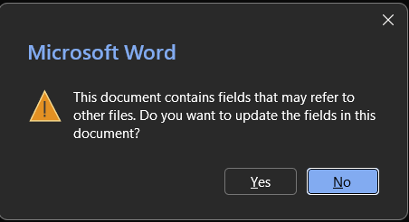
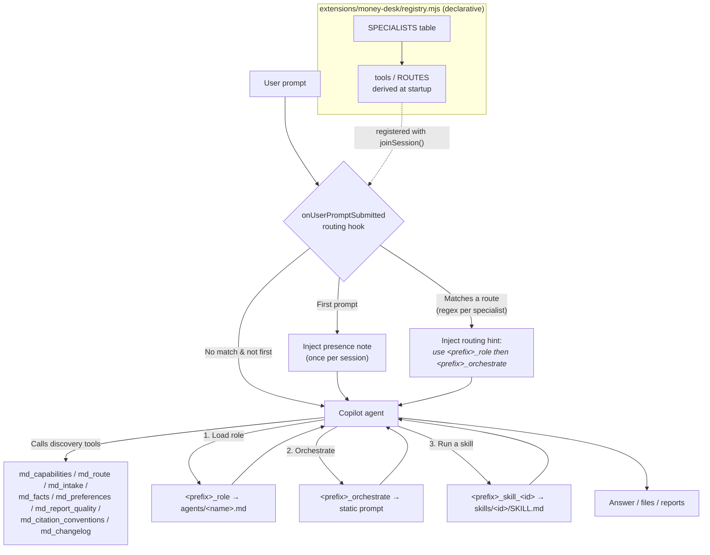
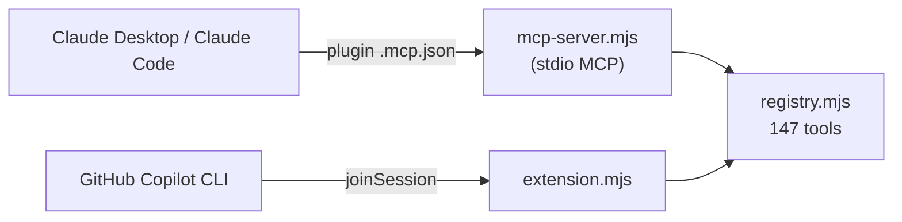

# Money Desk

[](LICENSE)
[](https://nodejs.org/)

**Your personal-finance AI team for GitHub Copilot CLI and Claude (Desktop, Code, Cowork).** 20 specialist agents with 147 tools. **Every skill tool is intake-gated**: the first call returns the required-input checklist and forces the agent to ask the user the listed questions in plain language (or render a structured `ask_user` form when a schema is shipped) before re-invoking the skill with the answers — so reports get built on `[USER-PROVIDED]` values, not invented `[ASSUMPTION:]` ones. A bundled 2026 facts table (IRS limits, brackets, IRMAA, FAFSA, conforming-loan, FEIE) means figures get cited from `md_facts` instead of marked `[UNSOURCED]`. Covers budgeting, taxes, investing, retirement, debt, credit, health & Medicare, property & casualty insurance, life & disability insurance, estate hygiene, major purchase decisions, education / 529 planning, net worth & goals tracking, self-employed / 1099 planning, cross-specialist life-event playbooks (annual review, new baby, job change, home purchase, inheritance, layoff), real-estate investing, behavioral coaching, international / expat planning, financial literacy (plain-language explanations + glossary + paycheck/statement walkthroughs + beginner roadmap + teach-a-kid), and FIRE planning (financial-independence strategy, safe-withdrawal stress testing, pre-59½ bridge / pre-65 healthcare, withdrawal-order, geographic arbitrage) — routed automatically. Zero runtime dependencies.

> [!WARNING]
> **Analysis only — not professional advice.** Money Desk produces drafts and analysis for your review. It does **not** execute trades, move funds, file taxes, submit disputes, or sign legal documents, and it is **not** a substitute for a licensed tax professional, fiduciary advisor, attorney, or insurance broker. It is informational only — **not professional tax, legal, investment, or insurance advice**.
>
> **🇺🇸 Scope: United States only.** Money Desk is built around US tax law, US account types (IRA / Roth / 401k / 529 / HSA), US insurance (ACA, Medicare, P&C), and US regulators (IRS, SSA, CMS, FAFSA). The 🌍 International / Expat desk covers cross-border topics from a **US-person perspective** only (FBAR, FATCA, FEIE vs FTC, PFIC) — it does **not** cover non-US home-country tax regimes.

---

### 📌 Table of Contents

| | Section | Description |
|---|---------|-------------|
| 🆕 | [What's New](#-whats-new) | v0.23.0 calculators; v0.22.0 compact mode; v0.21.0 deterministic skills + verified 2026 facts; v0.20.0 Claude support |
| 🚀 | [Quick Start](#quick-start) | One-command install |
| 💡 | [What is Money Desk?](#what-is-money-desk) | Overview and key concepts |
| 👥 | [The Team](#the-team) | All 20 specialists at a glance |
| 📦 | [Installation](#installation) | 5 ways to install for Copilot CLI + [Claude Desktop / Claude Code](#option-f--claude-desktop--claude-code--cowork-plugin) |
| 🖥️ | [CLI Reference](#cli-reference) | `init`, `status`, `uninstall`, `--version` |
| 📝 | [Usage Examples](#usage-examples) | Example prompts for every specialist |
| 🔒 | [Privacy & Guardrails](#privacy--guardrails) | What Money Desk will and won't do (full: [PRIVACY.md](./PRIVACY.md)) |
| ⚙️ | [How It Works](#how-it-works) | Architecture, routing, discoverability |
| 📂 | [Repository Structure](#repository-structure) | Folder tree and conventions |
| 📜 | [Changelog](#changelog) | Release history ([CHANGELOG.md](./CHANGELOG.md)) |
| 🔧 | [Troubleshooting](#troubleshooting) | Common issues and fixes |
| 🤝 | [Contributing](#contributing) | How to add a specialist or skill |
| 📄 | [License](#license) | MIT |

> 📋 **Full machine-readable capability map:** [docs/CAPABILITIES.md](./docs/CAPABILITIES.md) — auto-generated from the registry, lists every specialist, skill, and tool.

## 🆕 What's New

### v0.23.0 — Calculators: the math now runs in code

A new `md_calc` tool does the arithmetic the skills used to leave to the model, so the same inputs give exactly the same numbers every time.

| Calculator | What it computes |
|---|---|
| `debt_payoff` | Avalanche vs snowball month-by-month schedules, total interest, payoff dates, and the recommended method |
| `loan_amortization` | Payment, total interest, balance at any month, effect of extra payments |
| `refinance` | Break-even, hold-period cost, lifetime interest, NPV |
| `rmd` | This year's required minimum distribution per account, from the IRS table |
| `retirement_projection` | Balance at retirement, depletion age, gap, sensitivity grid, stress test, gap-closing levers |
| `savings_goal` | Monthly amount needed to reach a target |
| `federal_income_tax` | 2026 tax, marginal rate and bracket headroom for all four filing statuses |

24 skills now call these instead of doing the math by hand. Also in this release: head-of-household and married-filing-separately brackets added, and a $25 error in two single-filer bracket thresholds (introduced in v0.21.0) corrected.

### v0.22.0 — Lighter tool list for Claude Desktop chat

The Desktop Extension now runs the server in **compact mode**: 12 tools (about 2k tokens) instead of 146 (about 36k), with every specialist still reachable through one `md_call` tool. Set `MONEY_DESK_TOOLS=compact` to use it with a manual MCP config. The npm package is also about 40% smaller.

### v0.21.0 — Deterministic skills and verified 2026 facts

Same inputs now give the same report, on any model.

| What | Details |
|---|---|
| 🎯 **Determinism rules in every skill** | All 95 skills define their input keys, where each assumption comes from, the exact calculation (formulas, rounding, tie-breaks), numeric decision thresholds, and a fixed report template. See [docs/SKILL_DETERMINISM.md](./docs/SKILL_DETERMINISM.md). |
| ✅ **2026 facts re-verified** | Tax brackets, capital-gains ceilings, AMT, QBI, estate exemption, SALT cap, Social Security, Medicare / IRMAA, FEIE, loan limits and poverty guidelines corrected against IRS, SSA, CMS, FHFA and HHS sources. |
| 📐 **New reference data** | IRS RMD Uniform Lifetime Table, 2026 QCD limit, single-filer brackets, Part D IRMAA. |
| 🔗 **No dead ends** | Every tool a skill points to now exists, enforced by a test. |

### v0.20.0 — Money Desk now runs in Claude

Money Desk is no longer Copilot-only. The repo is now a **Claude plugin**, so the same 20 specialists and 146 tools work in **Claude Desktop** (Cowork and Code tabs, plus the chat tab via MCP), **Claude Code**, and **Copilot CLI**.

| What | Details |
|---|---|
| 🔌 **Claude plugin + marketplace** | Install with `/plugin marketplace add dmauser/money-desk` → `/plugin install money-desk@money-desk`. |
| 🧠 **MCP server** | `extensions/money-desk/mcp-server.mjs`: zero-dependency stdio server that serves the exact tools in `registry.mjs`. One source of truth for both hosts. |
| 🧭 **Router skill** | `skills/money-desk/SKILL.md` makes Claude use the Money Desk specialists for any personal-finance request. |
| 🖥️ **Claude Desktop chat** | Desktop Extension (`npm run build:mcpb`) or a `claude_desktop_config.json` entry, with an optional reports folder (`MONEY_DESK_WORKDIR`). |
| 📝 **Intake forms in Claude** | Gated skills ask their intake questions with Claude's question tool (or in chat), then run with your answers. Same `[USER-PROVIDED]` guarantee as in Copilot. |

See [Option F](#option-f--claude-desktop--claude-code--cowork-plugin) to install, and [CHANGELOG.md](./CHANGELOG.md) for the full history.

---

## Quick Start

```bash
npx github:dmauser/money-desk init
```

That's it. Launch Copilot CLI with experimental mode (`copilot --experimental`) in any repo and start asking personal-finance questions.

**Using Claude instead?** In Claude Desktop or Claude Code:

```text
/plugin marketplace add dmauser/money-desk
/plugin install money-desk@money-desk
```

See [Option F](#option-f--claude-desktop--claude-code--cowork-plugin) for Claude Desktop chat and manual MCP setup.

> _New to Copilot CLI?_ Install it from the [GitHub Copilot CLI docs](https://docs.github.com/copilot/concepts/agents/about-copilot-cli) first, then come back here.

## What is Money Desk?

Money Desk gives you a coordinated team of personal-finance specialist agents through [GitHub Copilot CLI](https://docs.github.com/copilot/concepts/agents/about-copilot-cli). Describe what you need — a budget review, a tax-loss harvest plan, a retirement projection, a buy-vs-lease analysis — and the coordinator routes your request to the right specialist automatically.

Each specialist runs with its own domain expertise, guardrails, and step-by-step playbooks. The coordinator handles routing and multi-domain orchestration so you don't have to remember which tool to call.

> **Analysis only** — Money Desk produces drafts and analysis for your review. It does **not** execute trades, move funds, file taxes, submit disputes, or sign legal documents. It is informational only — **not professional tax, legal, investment, or insurance advice**.

> **Local & private** — Money Desk has **no telemetry, no analytics, and no network calls** of its own. Your statements, tax docs, account data, and credit reports stay on your machine. See [Privacy & Guardrails](#privacy--guardrails) (and the full [PRIVACY.md](./PRIVACY.md)) for the complete data-flow.

> 🇺🇸 **Scope: United States.** Money Desk is built around US tax law, US account types (IRA / Roth / 401k / 529 / HSA), US insurance (ACA, Medicare, P&C), and US regulators (IRS, SSA, CMS, FAFSA). The **🌍 International / Expat** desk covers cross-border topics from a **US-person perspective** (FBAR, FATCA, FEIE vs FTC, PFIC) — it does **not** cover non-US home-country tax regimes. Country-agnostic desks (💰 Budget Coach, 🧠 Behavioral Coach, 📚 Financial Literacy, 📊 Net Worth & Goals) are usable anywhere.

## The Team

Twenty specialists, one coordinator. Say what you need in plain English — the router picks the right desk.

| | Specialist | What They Do |
|---|------------|--------------|
| 💰 | **Budget Coach** | Cashflow reviews, category audits, zero-based monthly plans, subscription cleanup |
| 🧾 | **Tax Planner** | Return-prep checklists, withholding checks, deductions reviews, tax-loss harvesting |
| 📈 | **Investing Advisor** | Portfolio reviews, allocation checks, rebalance plans, fund-expense audits |
| 🏖️ | **Retirement Planner** | Retirement projections, contribution optimization, withdrawal sequencing, Social Security |
| 💳 | **Debt Strategist** | Payoff plans (avalanche/snowball), refinance analysis, credit-card strategy, student loans |
| 🛡️ | **Credit & Identity** | Credit-report reviews, score-improvement plans, dispute letters, ID-theft response |
| 🏥 | **Insurance — Health & Medicare** | Health-plan selection (HDHP+HSA vs PPO), Medicare IRMAA, LTC planning |
| ☂️ | **Insurance — Property & Casualty** | Auto / home / renters declarations-page audit, deductible optimizer, umbrella sizing |
| 🪢 | **Insurance — Life & Disability** | Life-insurance needs (DIME/HLV), individual disability review, beneficiary audit |
| 📜 | **Estate & Legacy** | Document inventories, beneficiary audits, basics checklist, digital-estate review |
| 🛒 | **Purchase Advisor** | Buy-vs-lease, rent-vs-buy, big-purchase reviews, total cost of ownership |
| 🎓 | **Education Planner** | 529 reviews, college-cost projections, FAFSA / financial-aid positioning, account-type selection |
| 📊 | **Net Worth & Goals** | Net-worth snapshots, emergency-fund sizing, goal-based savings plans, sinking funds |
| 🧑‍💻 | **Self-Employed Planner** | Solo 401k / SEP / SIMPLE selector, quarterly estimated taxes, S-corp election, Schedule C / QBI review |
| 🗓️ | **Life Events** | Cross-specialist orchestrator — annual review, new baby, job change, home purchase, inheritance, layoff playbooks |
| 🏘️ | **Real Estate Investor** | Rental-property underwriting (cap rate, cash-on-cash, DSCR), mortgage/refi strategy, house-hacking, real-estate tax strategy (depreciation, 1031, cost segregation), sell-vs-hold |
| 🧠 | **Behavioral Coach** | Panic / FOMO circuit-breaker, money-script diagnostic, decision journal, couples money alignment, lifestyle-inflation audit |
| 🌍 | **International / Expat** | US-expat tax overview (FBAR, FATCA, FEIE vs FTC), cross-border investing (PFIC traps), currency/FX exposure, moving-country checklist |
| 📚 | **Financial Literacy** | Plain-language concept explainer (depth-calibrated), glossary lookups, paycheck walkthrough, account-type map, money-myths debunk, statement walkthrough (brokerage/401k/mortgage/EOB), 12-month beginner roadmap, teach-a-kid lessons + custodial Roth IRA pitch |
| 🔥 | **FIRE Planner** | Financial-Independence / Retire-Early strategy: FIRE number calculator, safe-withdrawal stress test (Bengen / Trinity / Kitces / VPW), lean / coast / barista / chubby / fat classifier, savings-rate optimizer, pre-59½ bridge strategy (SEPP/72(t), Roth ladder), pre-65 healthcare plan (ACA-MAGI / HSA), withdrawal-order optimizer, geographic arbitrage planner |

> 🔖 Each specialist also has a short tool **prefix** (e.g. `md_bc`, `md_tx`) used in the underlying tool names and in `md_route` / `md_capabilities` output. You almost never need to type these yourself — see **[docs/PREFIXES.md](./docs/PREFIXES.md)** for the full prefix map and how the per-specialist tools are named.

## Installation

### Prerequisites

- [GitHub Copilot CLI](https://docs.github.com/copilot/concepts/agents/about-copilot-cli) installed and authenticated.
- [Node.js 18+](https://nodejs.org/).
- **Experimental mode** (for user-level install) — enable with `copilot --experimental` or `/experimental` inside Copilot CLI. Not needed for project-level install.

### Option A — User-level install (recommended)

The fastest way. Extensions load in every repo, but require **experimental mode**:

```bash
npx github:dmauser/money-desk init
```

Then launch Copilot with experimental mode:

```bash
copilot --experimental
```

This will:
1. Create `~/.copilot/extensions/money-desk/` if it doesn't exist.
2. Copy the extension router and all 20 specialists.
3. Display a summary of what was installed.

### Option B — Project-level install (no experimental mode needed)

Installs the extension into the current repo's `.github/extensions/` directory. Works without experimental mode, but only for this repo.

> **Important:** You must run this from inside a git repository. If you don't have one yet, run `git init` first.

```bash
cd my-repo
npx github:dmauser/money-desk init --project
```

Then launch Copilot normally:

```bash
copilot
```

This will:
1. Create `.github/extensions/money-desk/` in the current repo.
2. Copy the extension router and all 20 specialists.
3. Add the extension directory to `.gitignore` (each developer runs init themselves — keep secrets out of source).

### Option C — Global install via npm

If you prefer a persistent CLI command instead of `npx`:

```bash
npm install -g github:dmauser/money-desk

# User-level install (requires experimental mode)
money-desk init

# Or project-level install (no experimental mode needed)
money-desk init --project

# Now available as a command:
money-desk status
money-desk --version
```

### Option D — Install from inside Copilot CLI

Already have Copilot CLI open? Just ask:

```
Clone https://github.com/dmauser/money-desk.git and run `node bin/cli.mjs init` from the cloned directory.
```

Or if you already cloned the repo and are inside it:

```
Run `node bin/cli.mjs init` to install the money-desk extension.
```

Copilot will execute the commands, copy the extension into `~/.copilot/extensions/money-desk/`, and confirm the result. Restart Copilot CLI after install to load the new extension, then verify with:

```
show me the money-desk capabilities
```

### Option E — Manual install (offline / corporate environments)

<details>
<summary>Click to expand manual steps</summary>

Use this if you're behind a corporate proxy or don't have npm/npx access.

**Step 1 — Clone the repo:**

```bash
git clone https://github.com/dmauser/money-desk.git
cd money-desk
```

**Step 2 — Copy to your Copilot extensions directory:**

macOS / Linux:

```bash
mkdir -p ~/.copilot/extensions/money-desk
cp -r extensions/money-desk/* ~/.copilot/extensions/money-desk/
```

Windows (PowerShell):

```powershell
$dest = "$env:USERPROFILE\.copilot\extensions\money-desk"
New-Item -ItemType Directory -Force -Path $dest | Out-Null
Copy-Item -Path "extensions\money-desk\*" -Destination $dest -Recurse -Force
```

**Step 3 — Verify the files are in place:**

```bash
ls ~/.copilot/extensions/money-desk/
# Should show: extension.mjs  registry.mjs  specialists/
```

</details>

### Option F — Claude Desktop / Claude Code / Cowork (plugin)

This repo is also a **Claude plugin** and a one-plugin **marketplace**. The plugin bundles a zero-dependency MCP server (`extensions/money-desk/mcp-server.mjs`) that serves the same 147 tools as the Copilot extension, plus a `money-desk` router skill. Requires **Node.js 18+** on `PATH`.

**Claude Desktop (Cowork / Code tabs) and Claude Code:**

```text
/plugin marketplace add dmauser/money-desk
/plugin install money-desk@money-desk
```

In Claude Desktop you can also add the marketplace from **Customize → Plugins → Add marketplace** using `dmauser/money-desk`, then install **money-desk**. Restart the session, then ask *"what can money-desk do?"*.

**Claude Desktop chat (MCP only, no plugin):** either build a Desktop Extension with `npm run build:mcpb` and double-click `money-desk.mcpb`, or add the server to `claude_desktop_config.json` (Settings → Developer → Edit Config):

```json
{
  "mcpServers": {
    "money-desk": {
      "command": "node",
      "args": ["C:/path/to/money-desk/extensions/money-desk/mcp-server.mjs"],
      "env": { "MONEY_DESK_WORKDIR": "C:/Users/you/Documents/MoneyDesk" }
    }
  }
}
```

Add `"MONEY_DESK_TOOLS": "compact"` to `env` to list 13 tools instead of 147 (recommended for the chat tab, which loads every tool description up front; the Desktop Extension sets it for you). Specialists are then run through a single `md_call` tool.

`MONEY_DESK_WORKDIR` is optional — it pins where exported reports (`./money-desk/<specialist>/`) and the renderer cache are written. Without it, deliverables are rendered inline in chat (the default).

### Verify installation

After any install method:

```bash
# CLI verification:
npx github:dmauser/money-desk status

# Or launch Copilot CLI and ask:
copilot
> show me the money-desk capabilities
```

You should see all 20 specialists listed with their tools.

### Updating

There is **no auto-update**. The installer is a one-shot copy from the source repo into `~/.copilot/extensions/money-desk/` (or `.github/extensions/money-desk/` for project installs) — the Copilot CLI loads whatever files are sitting in that folder at session start. To get the latest you must:

1. **Refresh the source** (whichever way you originally installed):

   | Original install method | How to refresh the source |
   |---|---|
   | `npx github:dmauser/money-desk init` | nothing to do — `npx` re-fetches `main` on every invocation |
   | `npm install -g github:dmauser/money-desk` | `npm install -g github:dmauser/money-desk` again (re-pulls `main`) |
   | Clone + `node bin/cli.mjs init` | `git pull` in the clone |
   | Manual / offline copy | re-download the latest release zip |

2. **Re-run the installer** — it safely overwrites the existing install:

   ```bash
   # User-level
   npx github:dmauser/money-desk init

   # Project-level (run from inside the repo)
   npx github:dmauser/money-desk init --project
   ```

3. **Restart the Copilot CLI session.** The extension is loaded once at session start; running sessions do not hot-reload. Quit and re-launch `copilot` (use `copilot --experimental` for user-level installs).

4. **Verify** the new version is live:

   ```bash
   money-desk --version
   money-desk status
   ```

   Inside a new Copilot CLI session, `md_capabilities` should reflect any newly added tools (e.g. `md_preferences`).

> **Tip — check before you reinstall.** `money-desk status` prints the on-disk version side-by-side with the source-package version, so you can see whether a refresh actually changed anything before restarting Copilot CLI.

### Uninstall

```bash
# Using the CLI:
npx github:dmauser/money-desk uninstall

# Or manually:
# macOS / Linux
rm -rf ~/.copilot/extensions/money-desk
# Windows (PowerShell)
Remove-Item -Recurse -Force "$env:USERPROFILE\.copilot\extensions\money-desk"
```

## CLI Reference

The `money-desk` CLI manages installation of the Copilot extension. You can run it via `npx` or install it globally.

| Command | Description |
|---------|-------------|
| `money-desk init` | Install/reinstall extension to `~/.copilot/extensions/` |
| `money-desk init --project` | Install/reinstall extension to `.github/extensions/` in the current repo |
| `money-desk status` | Check installation status and Copilot CLI presence |
| `money-desk uninstall` | Remove installed extension (user scope) |
| `money-desk uninstall --project` | Remove installed extension (project scope) |
| `money-desk --version` | Show the installed package version |
| `money-desk help` | Show CLI help |

Common flags:

- `--dry-run` — preview changes without writing anything.

## Usage Examples

Just describe what you need in plain language — the router picks the right specialist automatically.

### 💰 Budget Coach

```
Review my last 12 months of bank statements and break my spending down by category.
```
```
Build me a zero-based monthly budget targeting 20% savings on a $9,500/mo net income.
```
```
Audit my recurring subscriptions across all my cards — what's bleeding me dry?
```
```
Run a cashflow review on the attached statements and find the leaks.
```

### 🧾 Tax Planner

```
What documents do I need to gather before filing my 2026 federal return? I have W-2 + 1099 + brokerage.
```
```
Run a mid-year withholding check on my latest pay stub — am I on track?
```
```
Is it worth itemizing this year, or am I better off with the standard deduction?
```
```
Find tax-loss harvesting candidates in my taxable brokerage before year-end.
```

### 📈 Investing Advisor

```
Review my portfolio across all accounts and tell me what's wrong.
```
```
Am I too aggressive at age 38 with 95% equities? Run an allocation check.
```
```
Build a tax-aware rebalance plan that uses new contributions first and avoids taxable selling.
```
```
Audit the expense ratios across all my funds and find cheaper substitutes.
```

### 🏖️ Retirement Planner

```
Project my retirement at age 60 — current balance $480k, $36k/yr contributions, $90k target spend.
```
```
Optimize my contribution waterfall: 401k traditional vs Roth, HSA, backdoor Roth IRA, taxable.
```
```
Sequence my withdrawals across taxable, traditional, and Roth — minimize lifetime tax.
```
```
When should I claim Social Security? Compare 62, FRA, and 70 with breakeven analysis.
```

### 💳 Debt Strategist

```
I have 4 credit cards, an auto loan, and a student loan. Build me a payoff plan — avalanche vs snowball.
```
```
Should I refinance my 7.25% mortgage to 6.50%? Closing costs are $4,800 and I plan to stay 6+ years.
```
```
Audit my credit-card mix — am I using the right card for each category?
```
```
Review my federal student loans for PSLF eligibility and IDR plan selection.
```

### 🛡️ Credit & Identity

```
Review my Equifax credit report and find inaccuracies I can dispute.
```
```
I'm 60 days out from applying for a mortgage — what can I do to boost my score?
```
```
Draft an FCRA dispute letter for the medical collection that shouldn't be there.
```
```
I think my SSN was leaked in a data breach — walk me through identity-theft response.
```

### 🏥 Insurance — Health & Medicare

```
Open enrollment is next week — compare the HDHP+HSA vs PPO for my family of four.
```
```
I'm turning 63 — what's my Medicare IRMAA going to look like at age 65 given my Roth conversion plan?
```
```
Should I buy a long-term-care policy now or self-insure? I'm 55 with $1.2M invested.
```

### ☂️ Insurance — Property & Casualty

```
Review my auto and home declarations pages — am I underinsured for liability given my net worth?
```
```
Should I raise my home insurance deductible to $5k and save on premium?
```
```
Do I need an umbrella policy? I have $850k in assets and a teenage driver.
```

### 🛡️ Insurance — Life & Disability

```
How much term life insurance do I need? I'm 38, two kids under 10, $185k income, $320k mortgage.
```
```
Review my employer's group disability — is it enough or do I need an individual policy?
```
```
Audit my beneficiaries across 401(k), IRA, life insurance, and bank PODs.
```

### 📜 Estate & Legacy

```
Inventory my estate documents — what do I have, what's missing, what's stale?
```
```
Audit beneficiaries across all my retirement accounts, life policies, and TOD accounts.
```
```
Walk me through the estate-planning basics — minimum docs every adult should have.
```
```
Plan for my digital estate — password manager handoff, crypto recovery, legacy contacts.
```

### 🛒 Purchase Advisor

```
Should I buy or lease a $52,000 Tesla Model Y? I drive 12k mi/year and keep cars 7+ years.
```
```
Rent vs buy: $625k house, $3,200 comparable rent, 5-year horizon. Run the numbers.
```
```
I want to spend $4,500 on a new mountain bike. Sanity-check this purchase for me.
```
```
Compare TCO of a Toyota RAV4 hybrid vs Tesla Model Y over 8 years and 100k miles.
```

### 🏘️ Real Estate Investor

```
Underwrite this rental: $385k SFR, $2,650 rent, 20% down at 7.25%. Run cap rate, cash-on-cash, and DSCR.
```
```
Should I refi my 6.875% mortgage now or wait? Break-even and PMI removal analysis.
```
```
Sell-vs-hold my old rental — $620k value, $1,800 cashflow, 6 years left of accelerated depreciation.
```

### 🧠 Behavioral Coach

```
The market just dropped 7% and I want to sell everything — talk me down with a circuit-breaker.
```
```
Diagnose my money script — I grew up poor and now I can't stop hoarding cash even though I'm 45 with no debt.
```
```
My partner is a spender and I'm a saver — help us align on a monthly money date format.
```

### 🌍 International / Expat

```
I'm a US citizen moving to Portugal next year — FBAR, FATCA, FEIE vs FTC, and what to do with my Vanguard accounts.
```
```
My German wife has €180k in a UCITS ETF — explain the PFIC trap and our options.
```
```
Build me a moving-country checklist: tax residency, banking, brokerage, healthcare, currency hedging.
```

### 📊 Net Worth & Goals

```
Build my net-worth statement from these account balances and tell me what's missing.
```
```
Size my emergency fund — I have a single income, two kids, and a $4,200/mo essentials baseline.
```
```
Set up sinking funds for a $30k car in 3 years, $15k home repairs, and a $10k vacation next summer.
```

### 🎓 Education Planner

```
Compare 529 plans for my state vs the best out-of-state plan for a 4-year-old.
```
```
My kid is a high-school junior — walk me through the FAFSA timeline and what to do about our taxable brokerage.
```
```
We have $80k in a 529 and the school cost $45k/yr — model superfunding vs pay-as-you-go vs Roth rollover of the excess.
```

### 🧑‍💻 Self-Employed Planner

```
I'm 1099 with ~$180k net — should I elect S-corp this year, and what reasonable salary should I pay myself?
```
```
Set up my quarterly estimated taxes and compare SEP-IRA vs Solo 401(k) vs Mega Backdoor for my numbers.
```
```
Audit my Schedule C — what business deductions am I likely missing (home office, mileage, QBI, health-insurance premium)?
```

### 🗓️ Life Events

```
Run my annual financial review across budget, taxes, investing, insurance, and estate.
```
```
I just got laid off with 4 months of severance — build me a layoff playbook (COBRA vs marketplace, 401k rollover, cash runway).
```
```
We're expecting our first baby — checklist for beneficiaries, term life, HSA/FSA, 529, will, and budget changes.
```

### 📚 Financial Literacy

```
Explain how Roth vs Traditional 401(k) actually works — assume I'm a smart beginner.
```
```
Teach me how bond ETFs lose value when rates rise — with a worked example.
```
```
What's the difference between APR, APY, and the effective interest rate on my credit card?
```

### 🔥 FIRE Planner

```
I want to retire at 45 with $1.8M — run the 4% / 3.5% SWR scenarios and tell me what's missing.
```
```
Compare Lean-FIRE, Coast-FIRE, and Barista-FIRE for my numbers and savings rate.
```
```
Build my Roth-conversion ladder for a 50-year early-retirement scenario.
```

### 🔀 Multi-Domain (cross-specialist workflows)

```
Build my full annual financial review: budget audit, tax plan, portfolio review, retirement check, insurance gaps.
```
```
I just got a $40k bonus — sequence it across debt payoff, retirement, and taxable investing.
```
```
I'm planning to retire in 5 years — run a retirement projection and align my withdrawal strategy, allocation, and Social Security claim age.
```
```
We're having our first child — update beneficiaries, term-life needs, 529 plan, will, and budget.
```

### 🔎 Discovery

```
show me the money-desk capabilities
```
```
what tools does the tax planner have?
```
```
route this query: "should I lease the new car or buy used?"
```

## Privacy & Guardrails

Money Desk is built around a strict set of guardrails baked into every specialist's role and orchestrator prompt:

- **Analysis only.** No trades placed, no funds moved, no documents filed, no disputes submitted, no payments sent.
- **Cite every number.** Every figure traces to its source document (statement page, tax form box, prospectus, declarations page). Numbers without a source are explicitly marked `[UNSOURCED]`.
- **Treat your data as untrusted local input.** Statements, CSVs, screenshots, credit reports, tax forms — these are parsed locally and never sent anywhere outside your Copilot CLI session.
- **Mask PII in shared snippets.** When showing examples or external excerpts, redact SSN, account numbers, and addresses.
- **Not professional advice.** Money Desk is informational only. For complex situations, engage a licensed tax pro, fiduciary advisor, attorney, or insurance broker in your jurisdiction.
- **MCP integrations are opt-in and public-data-only by default.** Money Desk recommends FRED / SEC EDGAR / TreasuryDirect / BLS / `.gov` fetch as authoritative sources for rates, fund expense ratios, Treasury yields, and inflation (see `md_sources`). If you wire any of those MCP servers into your Copilot CLI config, queries carry no PII — only public identifiers (series id, ticker, CUSIP, `.gov` URL). Money Desk's own runtime still makes zero outbound network calls.

Reports produced by Money Desk are written to `./reports/<specialist>/` or `./reports/<ACCOUNT>/` in the current working directory. They never leave your machine unless you share them yourself.

For the full, explicit data-flow and verification commands, see **[PRIVACY.md](./PRIVACY.md)**.

## Recommended Models

Money Desk's guardrails — citation tags, the disclaimer footer, intake-before-skill,
the `md_report_quality` pre-write check, friendly-name rendering, no inline HTML in
tables — are enforced via the system prompt and tool descriptions, **not** by the
SDK runtime. They work across all models supported by GitHub Copilot CLI, but
**adherence varies by model**.

For best results, prefer models that:

- Reliably follow long system prompts and multi-step tool-calling rules
  (e.g. calling `md_intake` before a skill, `md_report_quality` before any export).
- Are conservative with numerical claims — tax brackets, IRMAA tiers, contribution
  limits, FAFSA thresholds — and tag unsourced or assumed values with `[UNSOURCED]`
  / `[ASSUMED]` per `md_citation_conventions`.
- Honor output formatting constraints: friendly skill names instead of raw tool ids,
  no `<br>` inside table cells (the CLI markdown renderer prints them as literal text),
  Mermaid diagrams only where intended.

In practice, **frontier reasoning-tier models** (e.g. Claude Opus, GPT-5
high-reasoning, and equivalent top-tier offerings from other vendors) hold the
guardrails most reliably. Smaller / faster / lower-reasoning models still work but
are more likely to:

- Skip the disclaimer footer on long responses.
- Quote a tax bracket or IRMAA tier without a citation tag.
- Make assumptions silently instead of flagging them.
- Auto-write a deliverable file without first calling `md_report_quality` and
  offering an export.

If you notice consistent guardrail drift on a specific model, please open an issue —
the cure is usually a tighter prompt rule in `registry.mjs`, not a model swap.

## Report Quality & Formats

Every Money Desk deliverable — rebalance plan, portfolio review, tax analysis, retirement readiness, budget, debt plan, insurance review, estate summary, real-estate underwrite, etc. — follows a single shared standard surfaced by the `md_report_quality` tool. Source-of-truth: `extensions/money-desk/data/preferences.yaml` (the `report_quality:` block).

**Defaults:**

- **Output = markdown rendered inline in chat.** No files are written automatically.
- **At the end of every deliverable, the agent OFFERS** PDF / DOCX / XLSX / HTML. It only produces files if you accept (or asked for a format up front).
- **File naming when files are produced:** `./reports/<specialist-slug>/<skill>_<YYYYMMDD>[_scenario_<label>].<ext>`. What-if scenarios get a `_scenario_<label>` suffix — prior runs are never overwritten.

**Renderer toolchain** (ships in `extensions/money-desk/renderers/`, copied to `./reports/_renderers/` on first use in a project):

| Format | Stack | Install |
|--------|-------|---------|
| PDF  | Playwright + Chromium     | `pip install playwright markdown2 && python -m playwright install chromium` |
| HTML | markdown2 + inline CSS    | `pip install markdown2` |
| XLSX | openpyxl, real formulas   | `pip install openpyxl` |
| DOCX | python-docx, real styles  | `pip install python-docx markdown-it-py` |

XLSX workbooks use **real `=SUM` / `=IF` / `=NPV` / `=FV` / `=PMT` formulas** with shared Inputs / Scenarios sheets — edit one cell and every scenario updates. DOCX uses **real Word styles** (Heading 1/2/3, Title, Quote, List Bullet) and inserts a TOC field. PDF and HTML share the same Chromium pipeline and brand palette.

> **Note for Word `.docx` users — TOC update prompt.** The first time you
> open a Money Desk Word report, Word will show this dialog:
>
> 
>
> **Click "Yes."** This is expected and safe — the document doesn't link to
> any external files. The prompt fires because the cover page contains an
> auto-generated **Table of Contents** field, and Word fills it in from the
> Heading 1/2/3 styles in the body when you accept. If you click "No," the
> first page will appear empty (just the title + date); reopen the file and
> click Yes, or press `Ctrl+A` then `F9` to update fields manually.

**Brand:** primary `#1a4d8f`, accent `#2e7d32`, warn `#d4a017`, risk `#c0392b`, row stripe `#f5f7fb`; Segoe UI / Helvetica body, Letter paper, 0.55in margins; footer `Money Desk — <Specialist> · Page X of Y · <YYYY-MM-DD>`.

**Standard sections in every report:** title + scope → intake echo → headline findings (severity-ranked) → detailed analysis → before/after → prioritized recommendations (🔴/🟠/🟡) → action checklist (`[ ]`) → open items & assumptions → disclaimer footer.

**Override examples** you can type at any time:

- *"Just markdown is fine, skip the PDF."*
- *"Also produce a spreadsheet I can edit."*
- *"Draft me a Word doc for my CPA."*
- *"Send me a dashboard link."* (HTML)
- *"All four formats."*

Self-verification (file sizes, formula sanity, no broken table wraps, TOC + styles) runs before the agent declares the deliverable done.

### Keeping local renderers in sync

**Fully automatic — you don't have to do anything.** As of v0.19.1, the extension auto-syncs `./money-desk/_renderers/` from the bundled canonical renderers (a) every time the agent calls `md_report_quality`, and (b) right before every render-spec-emitting skill returns its workflow. The cache cannot be stale at the moment a deliverable is rendered. Warm-path overhead is ≈ 5 ms (in-memory canonical-hash cache + cache-side manifest match).

User-authored utilities you have placed alongside the renderers (e.g. `inspect_qa.py`) are never touched — only the files listed in the bundled `RENDERERS_MANIFEST.json` are managed.

**Diagnostics** (rare):

```text
@money-desk md_renderers_sync({mode: "check"})    # detailed drift table
@money-desk md_renderers_ensure                    # idempotent retry shim
```

Use `md_renderers_ensure` once (no args) if a render fails with `ImportError` or a missing-file error against a cached renderer script, then retry the render. As a defense-in-depth fallback, each renderer also prints a one-line `WARN  renderer drift: …` on stderr when its embedded `__renderer_version__` disagrees with its sibling manifest.

## How It Works

### Discoverability

Money Desk is designed so the host agent (Copilot CLI or Claude) finds and uses it on the **first turn**, without the user having to prove it exists. Three mechanisms work together:

1. **Keyword-rich entry-point tools.** `md_capabilities` and `md_route` are eagerly registered in the initial tool manifest and their descriptions include every domain keyword — `money-desk`, `@money-desk`, `personal finance`, `budget`, `taxes`, `investing`, `retirement`, `debt`, `credit`, `insurance`, `estate`, `purchase`, `buy vs lease`, `rent vs buy` — plus an explicit "**Call this FIRST**" instruction.
2. **Keyword-rich `*_role` tools.** Each of the 13 `<prefix>_role` tools starts with `"Money Desk specialist: <domain>."` and lists trigger phrases a user might say. This lets the agent's tool-search surface the right specialist directly.
3. **First-prompt presence note.** The `onUserPromptSubmitted` hook injects a one-time presence note on the first prompt of every session, telling the agent that money-desk is loaded and how to enumerate it via `md_capabilities`. A per-prefix routing hint is appended on subsequent prompts when their regex matches.

### Architecture



### Running in Claude (MCP)

In Claude, `extensions/money-desk/mcp-server.mjs` takes the place of `extension.mjs`. It is a thin, zero-dependency stdio MCP adapter that imports the same `tools` from `registry.mjs`, so every tool, intake gate, and facts lookup behaves identically. Claude has no Copilot-style prompt hooks, so discovery comes from two other places instead:

- **Server `instructions`** sent at MCP start-up: the presence note plus host-adaptation rules (`ask_user` becomes Claude's question tool or chat; `web_search` / `web_fetch` mean Claude's web tools; files are written only with filesystem access and an accepted export offer).
- **The `money-desk` router skill** (`skills/money-desk/SKILL.md`), which Claude loads whenever a request is about personal finance.



The routing hook fires **once per specialist per session** — subsequent matching prompts don't re-inject the same hint, so context doesn't fill up with duplicate routing blocks. The presence note also fires only once.

### Typical workflow

Each specialist follows a consistent pattern:

1. **Load the role** — `<prefix>_role` (e.g. `md_bc_role`) loads the specialist's persona, guardrails, and workflow.
2. **Orchestrate** — `<prefix>_orchestrate` provides step-by-step guidance.
3. **Run skills** — individual `<prefix>_skill_*` tools execute the actual playbook (e.g. `md_bc_skill_cashflow_review`).

You don't need to call these manually — just describe what you need and the routing hook handles it.

### Registry as the source of truth

All 147 tools are derived from a single declarative `SPECIALISTS` table in [`extensions/money-desk/registry.mjs`](extensions/money-desk/registry.mjs). That table — not `extension.mjs` or `mcp-server.mjs` — is what you edit to add or modify a specialist or skill. See [`CONTRIBUTING.md`](CONTRIBUTING.md) for the full how-to.

## Repository Structure

```
money-desk/
├── .claude-plugin/
│   └── marketplace.json                       # one-plugin marketplace → ./plugins/money-desk
├── claude-plugin/                             # Claude plugin sources: plugin.json + skills/ (router skill)
├── plugins/money-desk/                        # GENERATED Claude plugin (npm run build:plugin) — don't edit
├── manifest.json                              # MCPB Desktop Extension manifest (Claude Desktop chat)
├── bin/
│   └── cli.mjs                                # zero-dep Copilot installer
├── extensions/money-desk/
│   ├── extension.mjs                          # thin Copilot SDK entry — joinSession() + hooks
│   ├── mcp-server.mjs                         # thin Claude/MCP entry — stdio JSON-RPC
│   ├── registry.mjs                           # SPECIALISTS table — source of truth
│   ├── calculators.mjs                        # md_calc: deterministic math (pure, integer cents)
│   └── specialists/
│       ├── budget-coach/
│       │   ├── agents/budget-coach.md         # role markdown
│       │   └── skills/
│       │       ├── cashflow-review/SKILL.md
│       │       ├── category-audit/SKILL.md
│       │       ├── monthly-plan/SKILL.md
│       │       └── subscription-audit/SKILL.md
│       └── …                                  # 20 specialists, same shape (see The Team)
│   └── data/facts-2026.json                   # md_facts: verified 2026 limits, brackets, tables
├── tests/
│   ├── manifest-consistency.test.mjs          # every tool resolves to non-empty content
│   ├── routes.test.mjs                        # every route regex matches a canonical phrase
│   ├── installer.test.mjs                     # CLI smoke tests against a tmp repo
│   ├── claude-plugin.test.mjs                 # plugin version sync + MCP handshake
│   ├── skill-determinism.test.mjs             # every SKILL.md has the Determinism rules section
│   └── tool-references.test.mjs               # every md_* tool id in markdown is a real tool
├── docs/
│   ├── SKILL_DETERMINISM.md                   # the skill determinism standard
│   └── CAPABILITIES.md                        # auto-generated specialist / skill / tool map
├── .github/
│   ├── copilot-instructions.md                # conventions for AI agents working on this repo
│   └── workflows/ci.yml                       # Node 18/20/22 × ubuntu/windows + npm pack
├── README.md
├── CONTRIBUTING.md
├── LICENSE                                    # MIT
└── package.json                               # no runtime deps
```

## Changelog

See **[CHANGELOG.md](./CHANGELOG.md)** for the full release history (notable changes, new specialists/skills, breaking changes, fixes).

Quick check of the installed version:

```bash
npx github:dmauser/money-desk --version
```

## Troubleshooting

**`copilot` doesn't see the money-desk tools after install.**
- Restart Copilot CLI.
- For user-level install, launch with `copilot --experimental`.
- Verify with `npx github:dmauser/money-desk status`.

**Claude doesn't see the money-desk tools after installing the plugin.**
- Make sure Node.js 18+ is on `PATH` (`node --version`). The MCP server is launched with `node`.
- Start a new session (or restart Claude Desktop) after installing.
- In Claude Code, run `/mcp` and check that `money-desk` is connected; `claude plugin validate <path-to-repo>` checks the manifests.
- To test the server alone: `npm run mcp`. It should print `MCP server … ready` on stderr and wait for input.

**Claude Desktop says "Marketplace sync failed. Check the repository URL and try again."**
- Update to v0.21.1 or later. Earlier versions kept the plugin at the repository root, which Claude Desktop's marketplace sync rejects (the CLI accepted it). Remove the marketplace in **Customize → Plugins → Manage marketplaces** and add `dmauser/money-desk` again.
- If it still fails, the real reason is in the Desktop app's `claude.ai-web.log` (look for `MARKETPLACE_ERROR`).

**Exported reports land in an unexpected folder (Claude Desktop).**
- Set `MONEY_DESK_WORKDIR` (or the "Reports folder" option in the Desktop Extension) to the folder you want. Without it, deliverables stay inline in chat.

**`init` fails with "not in a git repository" for `--project`.**
- Run `git init` in the target repo first, then re-run.

**Tool resolution fails with `resultType: "failure"`.**
- Indicates a SKILL.md or role markdown is missing on disk. Re-run `init` to repair, or run `npm test` from a clone of the repo to see exactly which file is missing.

**Routing hook doesn't trigger on a clearly relevant prompt.**
- The route regexes are intentionally specific to avoid false-positive routing. Use the explicit `@money-desk` mention or call `md_capabilities` to enumerate the team. Open an issue if you have a recurring miss.

**Windows path issues during install.**
- Make sure you're running PowerShell (not legacy `cmd.exe`).
- Long-path support — enable in Windows if you hit `MAX_PATH` errors.

## Contributing

See [CONTRIBUTING.md](./CONTRIBUTING.md). PRs welcome.

Quick contributor checklist:
1. Add the entry to `SPECIALISTS` in `extensions/money-desk/registry.mjs`.
2. Create the role markdown + one SKILL.md per skill.
3. Add a canonical phrase to `tests/routes.test.mjs`.
4. Run `npm run docs:capabilities` to regenerate `docs/CAPABILITIES.md`.
5. Run `npm test` (all tests should pass — including the docs-sync and guardrails checks).

## License

[MIT](./LICENSE) © dmauser

---

> _Money Desk produces analysis, not actions. It is not a substitute for a licensed tax professional, fiduciary advisor, attorney, or insurance broker._
